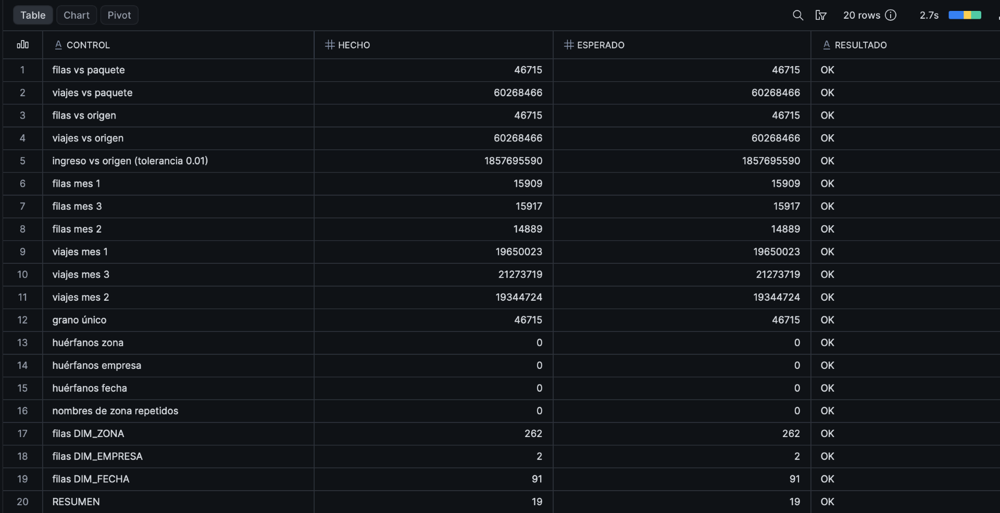

# Retos opcionales · Taller 1

Equipo: <nombres>. Los retos suman hasta +15 puntos (los puntos de los seis suman 17; el máximo que se acredita es 15).
Marca los que hicieron y di dónde está cada uno.

| Id | Reto | Pts | ¿Hecho? | Dónde está (archivo y línea o sección) |
|---|---|---|---|---|
| R1 | Un segundo caso completo (cinco preguntas más) | 3 | <no> | <...> |
| R2 | `DIM_FECHA` con festivos y fin de semana, usada en una consulta | 2 | <no> | <...> |
| R3 | Lluvia fuerte (más de 10 mm) frente a la línea base del mismo día de la semana (`AVG() OVER (PARTITION BY ZONA, DIA_SEMANA)`) | 3 | <no> | <...> |
| R4 | Suite de chequeos (grano, huérfanos, reconciliación con el conteo del paquete) en un solo archivo ejecutable | 3 | <sí> | <taller1/Retos_Opcionales/R4.sql> |
| R5 | Rachas de alta demanda (días consecutivos sobre un umbral; el problema de «huecos e islas») | 3 | <no> | <...> |
| R6 | Tabla externa de Athena sobre el paquete (la del Lab 4, E7) y reconciliación de conteos con Snowflake: filas por mes y viajes totales, con captura de `Data scanned` | 3 | <no> | <...> |

## Resultado de R4
