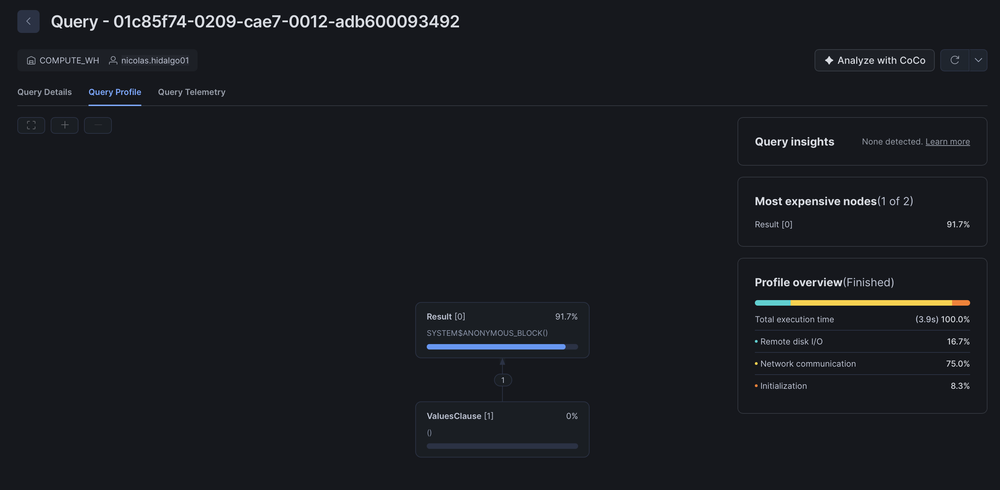
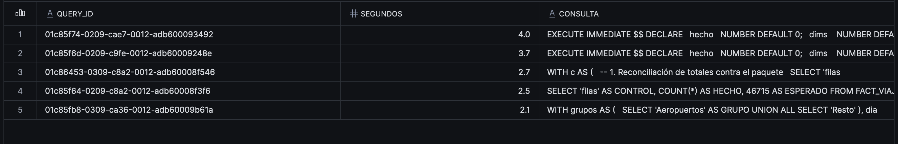

# Costos · Taller 1

Equipo: <Nicolas Hidalgo, Luis Armenta, Maiyan Yarce, Santiago Giraldo> · Cuenta que reporta (anfitrión): Nicolas Hidalgo

## Créditos usados

> Corre esta consulta en la cuenta del anfitrión (ajusta la fecha si mides otro día) y pega el resultado.

```sql
SELECT ROUND(SUM(CREDITS_USED), 4) AS CREDITOS
FROM TABLE(INFORMATION_SCHEMA.WAREHOUSE_METERING_HISTORY(
       DATE_RANGE_START => '2026-11-10'::DATE,
       WAREHOUSE_NAME => 'COMPUTE_WH'));
```

| Día medido | Warehouse | Tamaño | Créditos |
|---|---|---|---|
| 2026-11-13 | COMPUTE_WH | X-Small | 0.1322 |

Referencia de presupuesto (estimación del pensum, no medida): hasta 0.3 créditos el Lab 4 y hasta 0.8 el taller en clase.

## Consulta más pesada

- Consulta: <cuál es y a qué pregunta pertenece (por ejemplo, la 3 del caso A)>.


la Query pertenece a "verificar_t1.sql"

- Cómo la encontraste: usamos la seiguiente query para encontrarla

SELECT QUERY_ID, ROUND(TOTAL_ELAPSED_TIME / 1000, 1) AS SEGUNDOS,
       LEFT(QUERY_TEXT, 80) AS CONSULTA
FROM TABLE(INFORMATION_SCHEMA.QUERY_HISTORY(RESULT_LIMIT => 1000))
WHERE QUERY_TEXT ILIKE '%FACT_VIAJES_DIA%'
  AND QUERY_TEXT NOT ILIKE '%QUERY_HISTORY%'
ORDER BY TOTAL_ELAPSED_TIME DESC
LIMIT 5;



## Lectura del Query Profile

- Operador que concentra el tiempo: <nombre del operador y qué porcentaje del tiempo>.
- Qué harías para reducirlo: <una decisión concreta>.

## Warehouse

<Tamaño usado, suspensión automática (60 s) y si lo suspendiste al terminar.>
