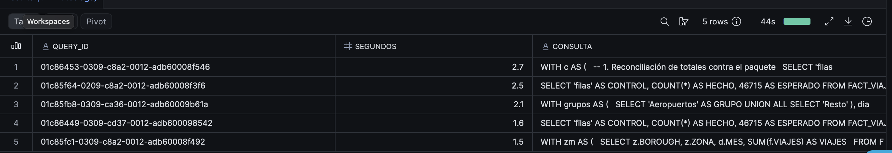

# Costos · Taller 1

Equipo: <Nicolas Hidalgo, Luis Armenta, Maiyan Yarce, Santiago Giraldo> · Cuenta que reporta (anfitrión): Nicolas Hidalgo

## Créditos usados

> Corre esta consulta en la cuenta del anfitrión (ajusta la fecha si mides otro día) y pega el resultado.

```sql
SELECT ROUND(SUM(CREDITS_USED), 4) AS CREDITOS
FROM TABLE(INFORMATION_SCHEMA.WAREHOUSE_METERING_HISTORY(
       DATE_RANGE_START => '2026-11-10'::DATE,
       WAREHOUSE_NAME => 'COMPUTE_WH'));
```

| Día medido | Warehouse | Tamaño | Créditos |
|---|---|---|---|
| 2026-11-13 | COMPUTE_WH | X-Small | 0.1322 |

Referencia de presupuesto (estimación del pensum, no medida): hasta 0.3 créditos el Lab 4 y hasta 0.8 el taller en clase.

## Consulta más pesada

- Consulta: 


la Query pertenece a "verificar_t1.sql"

- Cómo la encontraste: usamos la siguiente query para encontrarla

SELECT QUERY_ID, ROUND(TOTAL_ELAPSED_TIME / 1000, 1) AS SEGUNDOS,
       LEFT(QUERY_TEXT, 80) AS CONSULTA
FROM TABLE(INFORMATION_SCHEMA.QUERY_HISTORY(RESULT_LIMIT => 1000))
WHERE QUERY_TEXT ILIKE '%FACT_VIAJES_DIA%'
  AND QUERY_TEXT NOT ILIKE '%QUERY_HISTORY%'
  AND QUERY_TEXT NOT ILIKE '%EXECUTE IMMEDIATE%'
ORDER BY TOTAL_ELAPSED_TIME DESC
LIMIT 5;



## Lectura del Query Profile

- **Consulta:** la suite de chequeos (`05_suite_chequeos.sql`), 19 controles unidos con `UNION ALL`. Duró 1,7 s y leyó 1,51 MB.
- **Operador que concentra el tiempo:** ninguno en particular. Siete nodos pesan 11,1 % cada uno: varios `TableScan` de `FACT_VIAJES_DIA` y el `Aggregate` del `COUNT(DISTINCT ...)` del control de grano. Por categoría, el 55,6 % del tiempo es lectura de disco remoto.
- **Qué haría para reducirlo:** leer el hecho una sola vez. Hoy cada control recorre `FACT_VIAJES_DIA` por separado (46 715 filas por lectura). Calcularía filas, viajes, ingreso y grano en una sola consulta con agregación condicional, y los controles leerían ese resumen.
- **Contexto:** con 46 715 filas el costo es mínimo y el warehouse X-Small basta. La mejora importaría si el hecho creciera a millones de filas.

## Warehouse


- **Tamaño:** `COMPUTE_WH` en [X-Small]. Las consultas trabajan con 46 715 filas y leen cerca de 1,5 MB, así que un tamaño mayor no las aceleraría de forma útil y solo gastaría más créditos.
- **Suspensión automática:** [60] segundos, para que deje de consumir poco después de la última consulta.
- **Al terminar:** [lo suspendimos manualmente / ya estaba suspendido por la suspensión automática].
