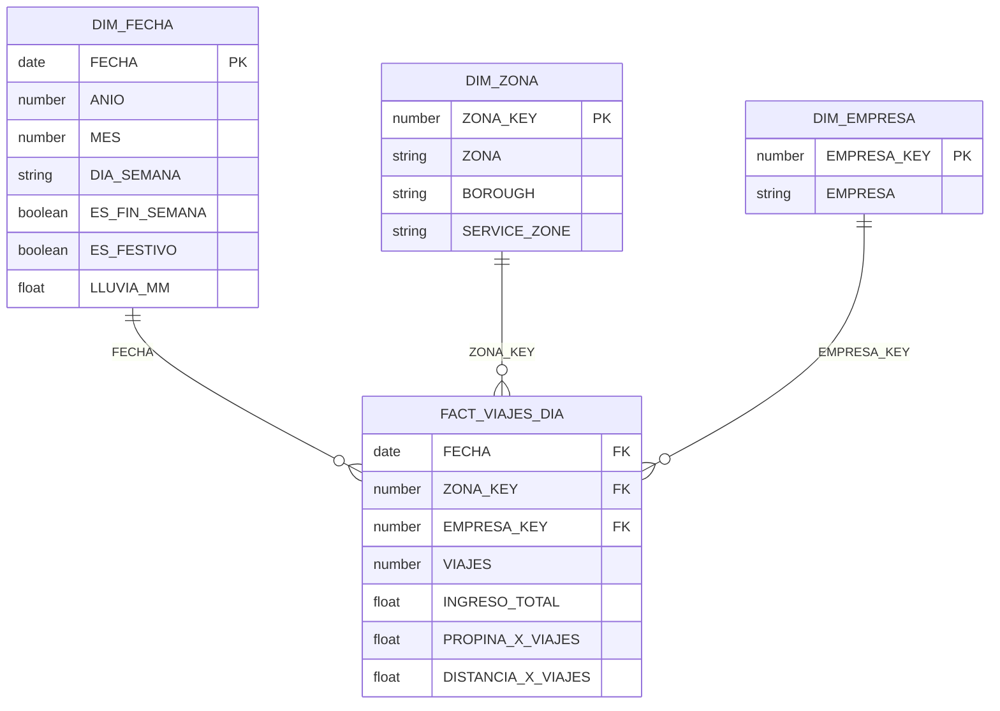

# Diagrama de la estrella · Taller 1

Equipo: <Nicolas Hidalgo, Luis Armenta, Santiago Giraldo, Maiyan Yarce>

# Diagrama de la estrella

Grano: una fila por fecha, zona y empresa.

## Claves

| Dimensión | Clave (PK) | Columna del hecho (FK) | Por qué es única en la dimensión |
|---|---|---|---|
| `DIM_FECHA` | `FECHA` | `FACT_VIAJES_DIA.FECHA` | Se generó un día por fila (91 días, de enero a marzo de 2024), sin repetir fechas. |
| `DIM_ZONA` | `ZONA_KEY` | `FACT_VIAJES_DIA.ZONA_KEY` | Llave sustituta creada con `ROW_NUMBER()` sobre `SELECT DISTINCT ZONA, BOROUGH, SERVICE_ZONE`: una fila por nombre de zona (262), así que no se duplican filas del hecho al unir. |
| `DIM_EMPRESA` | `EMPRESA_KEY` | `FACT_VIAJES_DIA.EMPRESA_KEY` | Llave sustituta creada con `ROW_NUMBER()` sobre `SELECT DISTINCT EMPRESA`: una fila por empresa (2). |

**Clave compuesta del hecho (el grano):** (`FECHA`, `ZONA_KEY`, `EMPRESA_KEY`). Cada combinación aparece una sola vez, por eso el hecho tiene 46 715 filas.

**Relaciones:** cada dimensión se relaciona con el hecho de uno a muchos (una fecha, zona o empresa puede aparecer en muchas filas del hecho).

**Nota:** en Snowflake las restricciones `PRIMARY KEY` se declaran pero no se hacen cumplir. La unicidad la garantiza la carga (`DISTINCT`) y la comprueban los chequeos de `04_chequeos.sql`.